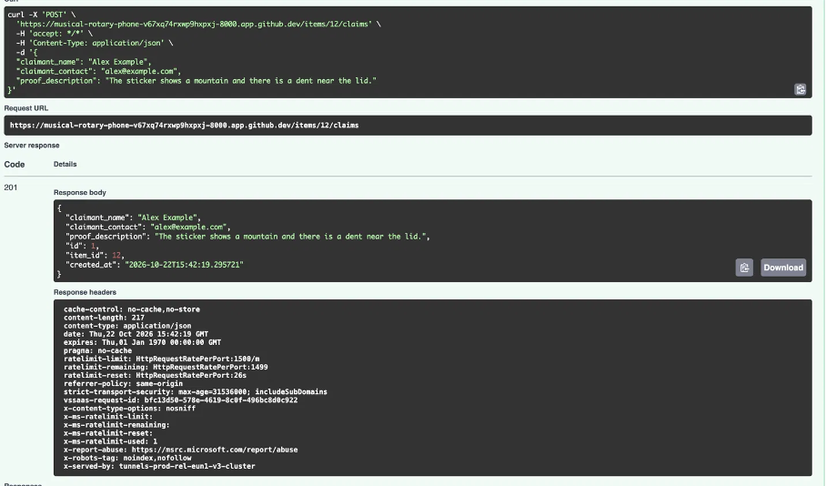
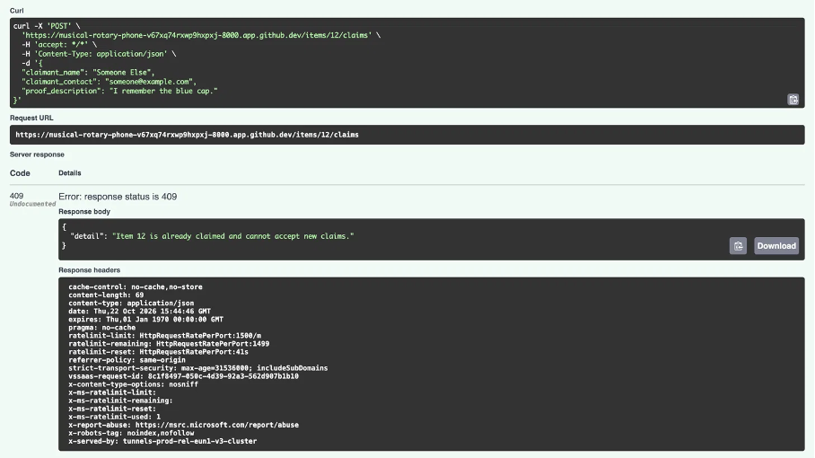
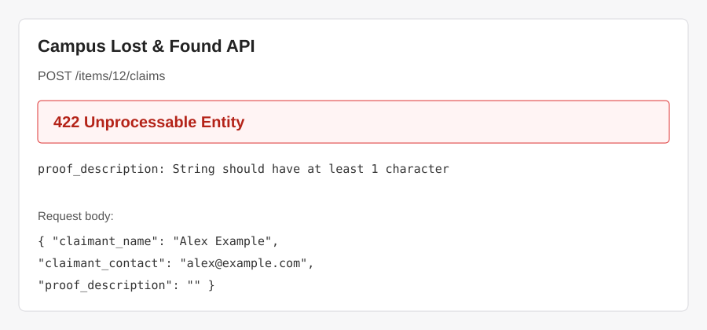

# Campus-Lost-Found-Hub---Project-

**Current stage:** Milestone 2 — contract and first implementation. This
README is the single living design document; we do not start a separate
document for each milestone.

The project uses the workflow, sketch and sample-data approach from the class
exercises, adapted to a campus lost-and-found service. Decisions made here are
the product contract for the next development phase.

## Project overview

Campus Lost & Found is a web application where students post items they have
**found** on campus, and students who are missing something can browse and
claim those posts. Today, lost items end up in scattered places: group chats,
notice boards and reception desks. Owners do not know where to look, and
finders do not have a clear handover process.

### Team and initial responsibilities

| Member | Initial responsibility | Next action |
|---|---|---|
| Fernando | Users and workflow | Describe the found-item and reclaim workflow |
| Bernardo | Sketches and interaction | Sketch the screens and feedback for that workflow |
| Ilir | Backend API and persistence | Implement the FastAPI endpoints, SQLModel database layer, SQLite/MySQL setup, tests and schema documentation |
| Davide | Coordination and README | Keep decisions, questions and the milestone record together |

These are starting responsibilities, not permanent silos. The team reviews
each other's work and rotates roles so everyone understands the whole draft.

## 1. Analysis

### Scenario, users and goals

- **Situation:** A student finds a water bottle, student card or jacket in a
  lecture hall. The owner is searching for it but has no central place to
  check.
- **Finder:** Wants to report a found item quickly, review plausible claims,
  and arrange handover without exposing personal contact details publicly.
- **Seeker / owner:** Wants to search by keyword, category and location,
  inspect trustworthy public details, and submit a claim containing a hidden
  ownership detail.
- **Campus staff / moderator:** Not part of this milestone. Authentication,
  moderation and user management remain future work.

The success case is a finder posting an item, the rightful owner submitting
the one active claim, the finder accepting the handover by marking the item
returned, and the item leaving the default search results.

### User stories and first workflow

- As a **finder**, I want to report a found item with a title, category,
  description, location, date and contact, so its owner can recognise it.
- As a **seeker**, I want to search and filter found items by keyword,
  category and location, so I can quickly check whether mine is listed.
- As a **seeker**, I want to claim an item with a hidden detail, so the finder
  can judge whether I am the owner.
- As a **finder**, I want to review claims and mark the item as returned after
  handover.

| Step | User / role | Action | Information needed | Expected result or feedback |
|---|---|---|---|---|
| 1 | Finder | Reports a found item | Title, category, optional description, place, date, contact | Item is created as `open`; a reference is returned |
| 2 | Seeker | Browses or searches items | Keyword, category, location and optional status | Matching public items and a result count |
| 3 | Seeker | Opens an item and submits a claim | Name, contact, hidden proof detail | Claim is created; item becomes `claimed` |
| 4 | Finder | Reviews the claims | Claimant name, contact and proof | Finder decides whether to arrange handover |
| 5 | Finder | Completes handover or reopens the item | Item reference | Status becomes `returned`, or returns to `open` |

Only one claim can lock an item at a time. A simultaneous or later claim
receives `409 Conflict`; claims are not queued. Claims are retained as
historical records. Reopening a claimed item is represented by
`PATCH /items/{id}` with `{"status":"open"}`; no separate claim-rejection
endpoint exists in this milestone.

**Out of initial scope:** login, campus accounts, payments, rewards, chat,
automatic matching, notifications, photo upload, lost-item posts, deletion,
moderation and automatic expiration.

## 2. Design

### Screens and navigation

The existing [admin wireframe](assets/admin-view-wireframe.drawio.svg) is an
early exploration, not a normative scope definition. Its review-queue,
manage-users and report-approval controls are deferred with moderation. The
current design uses these screens:

| Screen | Main inputs | Main actions | Feedback | Supporting operation |
|---|---|---|---|---|
| Found items list | Search text, category, location, status | Search, filter, open item | Result count or no-results message | `GET /items` |
| Report found item | Title, category, optional description, location, date, contact | Submit | Reference, `open` status, validation errors | `POST /items` |
| Public item detail | Item reference | View, submit claim | Public details, claim form, claimed/returned notice | `GET /items/{id}`, `POST /items/{id}/claims` |
| Finder claim review | Item reference | Review claims and reopen or return the item | Claim list and updated item status | `GET /items/{id}/claims`, `PATCH /items/{id}` |
| Finder item management | Item reference | Mark returned | `returned` status and hidden default listing | `PATCH /items/{id}` |

A polished or clickable prototype is not required for this milestone.

### Domain concepts and example data

The domain has two records:

- An **Item** is a found object with one current status and zero or more
  historical claims.
- A **Claim** is a seeker's ownership assertion and belongs to one item.
  Claims are retained as historical records; the current model has no
  separate claim status.

The category list is fixed because category filtering is part of the core
workflow. The canonical list is stored in
[`docs/examples/categories.json`](docs/examples/categories.json):
`bottle`, `keys`, `clothing`, `electronics`, `id_card`, `bag`, `other`.

The examples are fictional. [`found_item.json`](docs/examples/found_item.json)
shows the public item representation; the private finder contact is supplied
when reporting an item but is never returned publicly.
[`claim.json`](docs/examples/claim.json) shows a finder-only claim record.

#### Item state machine

| Current state | Next state | Trigger | Actor |
|---|---|---|---|
| `open` | `claimed` | A valid claim is accepted atomically | System after seeker submits |
| `claimed` | `open` | Finder reopens the item after reviewing the claim | Finder |
| `claimed` | `returned` | Handover is complete | Finder |
| `returned` | — | Terminal state | — |

There is no `expired` item state in this milestone. There is no automatic
expiration job, and `expired` must not appear as a valid status in the API.

#### Claim records

A claim is created when an item changes from `open` to `claimed` and is
retained after the item is reopened or returned. The current API does not
assign claim statuses, delete claims, or provide a separate rejection
operation. The finder claim list is the finder-only view of these records.

#### Privacy boundary

| Endpoint / view | Seeker can see | Finder-only data |
|---|---|---|
| `GET /items` | Public item fields, excluding finder contact | Finder contact |
| `GET /items/{id}` | Public item fields and claim count, excluding finder contact | Finder contact |
| `POST /items` response | Public item fields only | Submitted finder contact |
| `POST /items/{id}/claims` response | Claim identifier, item identifier, claimant name/contact and timestamp; never proof | Proof description |
| `GET /items/{id}/claims` | Not a seeker view | All claims, including claimant contact and proof |

The finder must not put phone numbers, student numbers or other sensitive
details in public title, description or location fields. `id_card` is an
allowed category, but redaction and special handling for sensitive objects are
deferred until authentication and moderation are designed.

### Business rules and operations

- `title`, `category`, `location_found`, `date_found` and `finder_contact`
  are required when reporting an item; `description` is optional.
- `category` must be one of the seven values in `categories.json`.
- `date_found` must not be in the future.
- Claim input requires `claimant_name`, `claimant_contact` and a non-empty
  `proof_description`.
- An item can receive a claim only while `open`.
- The first successful claim atomically locks the item as `claimed`; another
  claim receives `409 Conflict`.
- Returned items are hidden from the default list, but may be requested with
  an explicit status filter.
- Reopening a claimed item retains its claim history and returns the item to
  `open`.
- No operation deletes items or claims in this milestone.

### Item operation contracts

| Operation | Input | Expected output | Possible errors |
|---|---|---|---|
| `POST /items` | Required title, category, location, date and finder contact; optional description | `201 Created` with an identifier and status `open`; finder contact omitted from response | `422` for missing/invalid fields |
| `GET /items` | Optional `q`, `category`, `location`, `status`, `limit` and `offset` | `200 OK` with public items, count, limit and offset | `422` for invalid filters or pagination |
| `GET /items/{id}` | Integer item identifier | `200 OK` with public item details and claim count | `404` if absent; `422` for invalid identifier |
| `PATCH /items/{id}` | `{"status":"returned"}` | `200 OK` with updated public item | `404` if absent; `409` for an invalid transition; `422` for malformed input |

### Claim operation contracts

| Operation | Input | Expected output | Possible errors |
|---|---|---|---|
| `POST /items/{item_id}/claims` | Item id, claimant name, contact and proof description | `201 Created`; one claim and item status `claimed` | `404` if item is absent; `409` if not open; `422` for invalid input |
| `GET /items/{item_id}/claims` | Item id; finder-only access in the future | `200 OK` with claims including proof | `404` if item is absent; authorization is deferred |

No authentication is claimed by this milestone; the finder-only boundary is a
documented future authorization requirement.

### Inspiration from existing apps or APIs

No external lost-and-found service is being integrated or copied for this
milestone. The design is based on the class exercise workflow, adapted to
campus items, with a deliberately small fixed category list and explicit
privacy boundaries.

No external API integration is planned for this milestone.

## 3a. API contract (Milestone 2)

### Operation: Claim a found item

- **User goal:** A seeker claims an item they believe is theirs.
- **Record affected:** A claim is created and the related item
  changes from `open` to `claimed`.

**Request:** `POST /items/{item_id}/claims`

```json
{
  "claimant_name": "Alex Example",
  "claimant_contact": "alex@example.com",
  "proof_description": "The sticker shows a mountain and there is a dent near the lid."
}
```

**Success response — 201 Created**

```json
{
  "claimant_name": "Alex Example",
  "claimant_contact": "alex@example.com",
  "id": 1,
  "item_id": 12,
  "created_at": "2026-10-22T15:42:19.295721"
}
```

The proof is accepted as input but is omitted from this public response.


**Failure response — 409 Conflict** (item is not `open`)

```json
{
  "detail": "Item 12 is already claimed and cannot accept new claims."
}
```



**Failure response — 422 Unprocessable Entity** (invalid input)

An empty `proof_description` is rejected before claim creation. The item
remains `open`:

```json
{
  "claimant_name": "Alex Example",
  "claimant_contact": "alex@example.com",
  "proof_description": ""
}
```



This case is covered by `test_claim_invalid_input_rejected` in
`tests/test_claims.py`.

### Responsibilities

| Layer | Responsibility | Location |
|---|---|---|
| API contract | Request fields, response fields and status codes | This README and the OpenAPI contract |
| Validation | Required fields, category, email and date rules | Schema boundary |
| Business rules | State transitions, one-claim lock and claim lifecycle | Application domain layer |
| Storage | SQLModel persistence for the configured SQLite database | `app/database.py`, `app/models.py` |

### Endpoint status

| Operation | Method & path | Planned | Implemented | Tested |
|---|---|---|---|---|
| Report found item | `POST /items` | ✅ | ✅ | ✅ |
| Browse/search items | `GET /items` | ✅ | ✅ | ✅ |
| View one item | `GET /items/{id}` | ✅ | ✅ | ✅ |
| Mark item as returned | `PATCH /items/{id}` | ✅ | ✅ | ✅ |
| Claim an item | `POST /items/{id}/claims` | ✅ | ✅ | ✅ |
| Review claims | `GET /items/{id}/claims` | ✅ | ✅ | ✅ |

The implemented operations are available through FastAPI's interactive docs
and are covered by the SQLite tests. An optional MySQL suite covers the core
scenarios and concurrent duplicate claims.

## 3. Project management

### Decisions, open questions and next steps

| Question / decision | Current position | Next step / owner |
|---|---|---|
| Do users need an account? | Yes, for a future secure release; no login in this milestone | Design authentication before production use / Team |
| How much is public? | Public item data excludes finder contact; proof and finder claim details are private | Add authorization before deployment / Team |
| How are sensitive items handled? | `id_card` is allowed, but special redaction and moderation are deferred | Define moderation policy / Team |
| Should seekers post lost items? | Out of scope for now | Revisit after this workflow / Team |
| Should photos be supported? | Out of scope for now | Revisit after the first workflow / Team |

### Coaching notes

To be completed after the next coaching session on a date to be agreed by the
team; no coaching feedback has been recorded in this milestone.

### Contributions

| Contributor | Contribution |
|---|---|
| Fernando | User roles and found-item/reclaim workflow |
| Bernardo | Screen sketches and interaction flow |
| Ilir | FastAPI item and claim API, Pydantic schemas, SQLModel persistence, SQLite test setup, MySQL compatibility and schema documentation |
| Davide | README structure, decisions and milestone coordination |

### Questions for the lecturer

1. Is the proposed future authentication approach appropriate for a campus
   deployment?
2. Is the planned finder authorization boundary sufficient for the next
   milestone?
3. Should special handling for `id_card` items be reviewed with campus staff?

## Getting started

1. Install Python 3.11+ and the dependencies:

   ```
   pip install -r requirements.txt
   ```

2. Start the development server:

   ```
   uvicorn app.main:app --reload
   ```

3. Open the interactive API docs at http://127.0.0.1:8000/docs.

4. Run the automated tests:

   ```
   python3 -m pytest
   ```

### Database

The application uses SQLModel with SQLite by default. Set `DB_URL` to point
the application at another SQLModel-supported database when needed. Tests
override this value with a fresh SQLite database.

Sample data is seeded only when both `DEBUG` and `SEED_SAMPLE_DATA` are true,
and only when the item table is empty. `init_db()` uses `create_all()` for
this course project; Alembic migrations are the production-grade follow-up
for schema evolution.

### Milestone progress

| Milestone | Available evidence | Status / next step |
|---|---|---|
| 1 — Design draft | Analysis, workflow, sketches and example JSON | Complete |
| 2 — Contract and first implementation | API contract, item and claim operations, validation and tests | Complete for the listed implemented endpoints |
| Integration — later | Authentication, finder authorization and a connected workflow | Plan after the next coaching session |

The complete milestones, dates and assessment criteria are in the Moodle
assignment. This README records the team's decisions and design evidence;
commit counts do not measure individual effort.

## 4. References and acknowledgements

- Class exercises and the bar-ordering scenario, adapted to a campus
  lost-and-found workflow.
- FastAPI, Pydantic, SQLModel and MySQL documentation consulted for the API,
  validation and persistence concepts.
- The diagrams in `assets/` were created as course design artifacts. The admin
  wireframe remains an exploratory reference; deferred controls are not part
  of the current scope.
